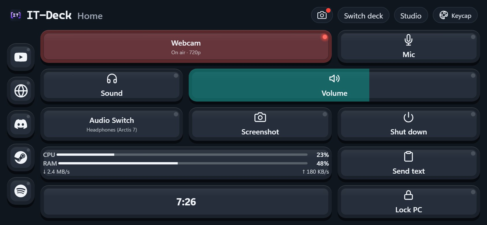

# Привет, я Itegin Baltabaev 👋

**Linux & Monitoring Engineer**
Москва, Россия · открыт к удалённым инфраструктурным / DevOps-ролям

🇬🇧 [English version](README.en.md)

---

### Обо мне

Единственный системный администратор в компании на двух площадках: Linux (Debian, Ubuntu, Astra), Windows Server и Proxmox VE. Внедрил мониторинг на Prometheus и Grafana с алертами в Telegram, заявки в Jira и базу знаний в Confluence, перевёл сервисы на Docker и k3s. До этого вёл всю IT-часть офиса на 8 рабочих мест. Занимаюсь мониторингом и разбором инцидентов, а свои сервисы довожу до продакшена сам.

**С чем работаю:**

-326CE5?style=flat-square&logo=kubernetes&logoColor=white)

---

### Проекты

<table>
<tr>
<td width="50%" valign="top">

**[IT-Deck](https://github.com/Itegin/it-deck)** ·  · [страница проекта](https://itegin.com/projects/it-deck)

Телефон или планшет (iPhone, Android, iPad) становится пультом и веб-камерой для Windows-ПК: живые тайлы, настройка по QR-коду, без сервера и Docker. Веб-камера работает в любом браузере телефона по собственному доверенному HTTPS-адресу, без профиля сертификата.

`Python` `FastAPI` `WebSocket` `WebRTC` `GitHub Actions`

</td>
<td width="50%" valign="top">

**itegin — личный сайт** *(исходники закрыты)*

Мой сайт-визитка и портфолио, написан с нуля: собственная аутентификация и админка (черновик → публикация), собственная аналитика Umami (без cookies), витрина GitHub, обновляемая по вебхуку и ежедневному таймеру, и раздел админки, который выдаёт подписанные ключи IT-Deck (Ed25519). Работает в продакшене на VPS.

`Flask` `SQLite` `Docker Compose` `nginx` `CI: ruff + pytest`

[→ живой сайт](https://itegin.com/?src=github) · [→ репозиторий-витрина](https://github.com/Itegin/pygodevops-guide-showcase)

</td>
</tr>
</table>

---

### Ключевое

- Единственный сисадмин на двух площадках компании: Linux, Windows Server, Proxmox VE, сеть, бэкапы, поддержка пользователей
- Внедрил **мониторинг на Prometheus + Grafana с алертами в Telegram**: о сбоях узнаю раньше пользователей
- Завёл **заявки в Jira и базу знаний в Confluence** с инструкциями; перевёл сервисы на **Docker и k3s**
- **IT-Deck**: публичный проект с релизами по тегам, тестами на Linux и Windows и Windows-сборкой `.exe` через CI
- Сам держу **продакшен-сервисы**: этот сайт работает в Docker за nginx + TLS на VPS, с автоматическими бэкапами

---

<picture>
  <source media="(prefers-color-scheme: dark)" srcset="https://raw.githubusercontent.com/Itegin/itegin/output/github-contribution-grid-snake-dark.svg">
  <source media="(prefers-color-scheme: light)" srcset="https://raw.githubusercontent.com/Itegin/itegin/output/github-contribution-grid-snake.svg">
  
</picture>

Открыт к удалённым инфраструктурным / DevOps-ролям. Пишите в [Telegram](https://t.me/itegin) или на [iteginbt@gmail.com](mailto:iteginbt@gmail.com).
